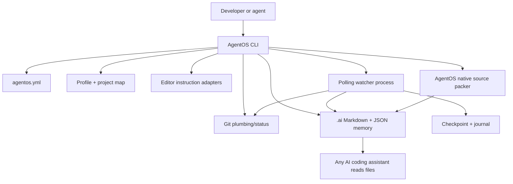
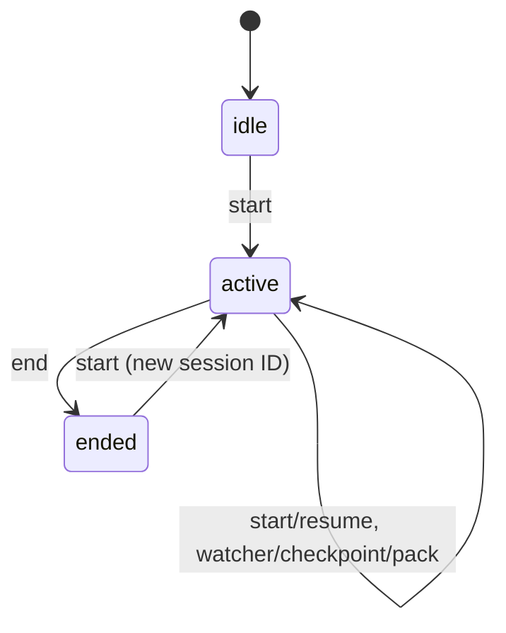

> v0.4.0 update: AST-aware smart extraction and token-budget semantics documented in [SMART_CONTEXT_ENGINE.md](SMART_CONTEXT_ENGINE.md). This document contains legacy v0.3 sections where they conflict; the v0.4 specification prevails.

# AgentOS — Technical Specification v1.2

## A. Runtime and boundaries

**Runtime:** Node.js >=20 / TypeScript compiled to native ESM. No runtime NPM dependencies. Dev dependencies: TypeScript and @types/node. **CLI binary:** `agentos`, implemented by `dist/src/cli.js`. Every project uses its own `.ai` directory. **Git** is the code source of truth. **The native packer** constructs context from Git-visible files using Node.js standard library; it performs no subprocess other than the Git inventory provided by the Git subsystem. Editors/agents are independent consumers of local files.



## B. Lifecycle state machine

**States:** `idle` (implicit pre-session), `active`, `ended`.



`start` on an active session reuses its ID and launches a replacement watcher if missing. This preserves task continuity after a crashed terminal session. `end` requires an active session; it stops the process, captures final Git metadata, builds latest pack, emits final checkpoint, saves session/handoff and journal. `resume` exports the last known state, but does not launch an AI worker. `init` never calls `git init` implicitly.

## C. Data formats and invariants

### Configuration (`agentos.yml`)

A deliberately strict YAML subset: two spaces for nested map keys, JSON-formatted inline arrays and scalars, comments on separate lines. No anchors, tags, multiline blocks, `${}` interpolation or environment expansion. Unknown top-level keys are rejected. Settings:

```yaml
version: 1
watcher:
  intervalSeconds: 10
  checkpointSeconds: 120
  packDebounceSeconds: 20
  autoStart: true
checkpoints:
  keep: 30
packer:
  enabled: true
  include: []
  ignore: []
  maxFiles: 200
  maxFileBytes: 131072
  maxTotalBytes: 2097152
  maxOutputBytes: 1048576
editorOrder: ["cursor", "claude", "windsurf", "cline", "roo", "kiro", "trae"]
customIgnore: []
```

Numbers are validated to specified limits. `editorOrder` controls which adapters to generate, not which AI should run. Legacy `repomix:` settings migrate at parse time without installing Repomix. Optional packing can be disabled explicitly.

### Session (`.ai/runtime/session.json`)

`{ id, state, startedAt, updatedAt, endedAt?, branch, head, task, lastCheckpoint, packStatus, lastError? }`. `id` is a random UUID-derived identifier. `packStatus`: `ready`, `disabled`, or `error` (`repomix-missing` remains a legacy state).

### Checkpoint (`.ai/checkpoints/<iso>-<uuid>.json`)

`{ id, createdAt, reason, sessionId, branch, head, changed, staged, untracked, fingerprint, taskHash, packStatus }`. Checkpoints are **not** a backup of file contents. Retention removes oldest JSON checkpoint files once the configured limit is exceeded.

### Profile (`.ai/PROJECT_PROFILE.json`)

`{ generatedAt, root, name, frameworks, languages, monorepo, include, packageManager }`.

### Journal (`.ai/journal/events.jsonl`)

Append-only JSON-per-line event records. Entries may include `initialized`, `session_started`, `checkpoint`, `change_detected`, `watcher_started`, `watcher_stopped`, `watcher_error`, `session_ended`.

### Memory Markdown

`AI_RULES.md` holds project-specific coding policies; `AI_CONTEXT.md` stores architectural decisions; `AI_TASK.md` is editable current intention; `SESSION.md` is machine-written summary; `AI_HANDOFF.md` is machine-written continuation; `PROJECT_MAP.md` shows detected project tree; `CHANGED_FILES.md` mirrors Git changes; `packs/current-task.md` contains bundled source sections or an explicit disabled notice; `packs/current-task.manifest.json` records included/skipped files, SHA-256 and budgets; `exports/handoff.md` concatenates relevant artifacts.

## D. Git subsystem

- Detect Git availability and worktree via `git --version` and `git rev-parse`.
- Branch through `git branch --show-current`; HEAD through `git rev-parse HEAD` (supports repos without commits).
- Dirty files through `git status --porcelain=v1 -z --untracked-files=all`; `-z` preserves spaces and special filenames. Exclude `.ai/` generated paths from the changed list.
- Fingerprint uses branch, head, dirty file names/stat info and staged diff raw metadata; watcher detects changes without reading/embedding source code.
- Project files identified through `git ls-files --cached --others --exclude-standard -z`.
- There are **no** automatic `git add`, `git commit`, `git reset`, `git clean`, `git push` or checkout operations.

## E. Deterministic project detection

React via dependencies, Next.js config or dependency, Vite config/dependency, Angular dependency, NestJS dependency/config, Express dependency or conventional route/application files; monorepo via `pnpm-workspace.yaml`, `turbo.json`, `nx.json`, `lerna.json`; Python, Go, Rust and Java via standard manifest files. Languages via file suffixes. Preset globs guide the internal packer. No inference model and no framework-specific API.

## F. Native context packing pipeline (v0.3)

1. Load configuration, the project profile, `.ai/AI_TASK.md`, the Git snapshot and Git's tracked/untracked inventory.
2. Rank files by exact task path mention, changed/untracked status, top-level configuration importance, then lexicographic order. Candidate selection is the union of presets, user includes, task mentions and changes; ignore rules always take precedence.
3. Apply built-in deny patterns for `.ai/`, `.git/`, dependency/build folders, sensitive names/extensions and user-provided ignores (using `*`, `**`, `?`). No glob negations. Git-ignored untracked paths never enter candidate inventory; explicitly Git-tracked paths still must pass packer exclusions.
4. For each candidate: reject symlinks at every ancestor, paths that resolve outside the project root, non-files, binary/invalid UTF-8, and size/budget violations. Refuse unexpectedly changed file sizes after reading.
5. Redact entire lines with recognized token/private-key/credential signatures. Do not treat this as comprehensive secret scanning.
6. Assemble stable Markdown with a variable-length backtick fence around each file, and metadata about task, branch, HEAD and changed file paths. Emit the pack and machine-readable manifest with atomic writes. No timestamp in the pack or manifest, so unchanged source yields byte-identical results.
7. A failed packing run leaves the previous pack intact. If disabled, write an explicit disabled marker. Runtime: only built-in Node APIs; external executable required: Git, which remains the source of truth.

**Limits:** `maxFiles` (1..10000), `maxFileBytes` (256..10 MiB), `maxTotalBytes` (1024..100 MiB), `maxOutputBytes` (1024..100 MiB). Defaults are intentionally modest. `estimatedTokens` = approximate UTF-16 code units / 4, *not* model-specific tokens. The output is not AST-aware, deduplicated at symbol-level or semantically compressed. Its purpose is reliable, selective project memory.

**Migrating v0.2:** read a legacy `repomix:` section and map `enabled`, `include`, `ignore`; discard obsolete `compress` and `timeoutSeconds`. Both `packer:` and `repomix:` together are rejected.

## G. Watcher daemon

A detached Node child re-runs the same executable in `__watch` mode. Session ID identifies its owner. A PID/heartbeat file lives in `.ai/runtime/watcher.json`. Polling reads Git fingerprint and task content hash at the configured interval. On change it refreshes source profile / changed file and records journal event. Packing is debounced. Periodic metadata checkpoints are retained. SIGTERM or SIGINT ends the process and removes its own PID file. The first watch tick immediately reconciles any changes that occurred between `start` and daemon startup.

Recovery: if session remains `active` after daemon crash, `agentos start` reuses its session ID and spawns a new process. `agentos end` attempts graceful termination before final snapshot. The daemon is best-effort on unexpected OS shutdowns.

## H. Rule adapters

Agent files are generated in marked managed sections, leaving unmanaged text unchanged:

| Agent/editor | File |
|---|---|
| Cursor | `.cursor/rules/agentos.mdc` |
| Claude Code | `CLAUDE.md` |
| Windsurf | `.windsurf/rules/agentos.md` |
| Cline | `.clinerules/agentos.md` |
| Roo | `.roo/rules/agentos.md` |
| Kiro | `.kiro/steering/agentos.md` |
| Trae | `.trae/rules/agentos.md` |
| Generic tools | `AGENTS.md` |

The instructions request reading memory and verifying source facts. These files are hints, not a security sandbox, and are not interpreted as instructions by AgentOS itself.

## I. Ignore file and generated file safety

`.agentosignore` and `.gitignore` use explicit `AGENTOS MANAGED` start/end markers. A missing half or reversed pair is a hard error; the generator refuses overwrite. Human edits outside the managed range are preserved. Runtime, packs, exports, journal and checkpoint files are `.gitignore`d; stable memory docs remain reviewable/committable. Atomic writes use temporary files in the destination directory plus rename.

## J. Command outcomes and error codes

Normal success returns exit 0; errors return exit 1 with `AgentOS error: ...`. `doctor` is exit 1 if required checks fail; a disabled native packer does not fail core health. `--json` outputs structured JSON for commands with return values. `--cwd PATH` chooses project scope; commands other than `init` search upward for `agentos.yml`.

## K. Versioning and extension boundary

Current version is `0.3.0` (local developer release). Future UI integrations (VS Code or web) may call `agentos ... --json`; they must contain no business logic. Future protocol versioning should preserve `.ai` portability and provide explicit migration scripts before changing memory layouts. Do not add AI dependencies to the core.
